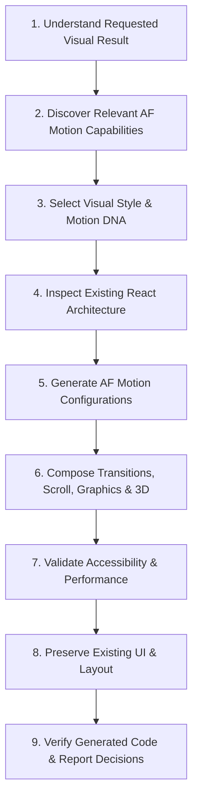

# Antigravity Agent Workflow for AF Motion

This document teaches Google Antigravity agents how to build, compose, and optimize motion within React and web codebases using **AF Motion**.

---

## The 9-Step Antigravity Motion Workflow

### Step 1: Understand the Requested Visual Result
- Analyze the user prompt to identify target elements, trigger events (mount, scroll, hover, press, continuous), and the desired emotional resonance (playful, technical, luxury, energetic).

### Step 2: Discover Relevant AF Motion Capabilities
- Inspect `skills/index.json` or the relevant `skills/<name>/SKILL.md` before writing code.
- Prefer existing AF Motion primitives over hand-crafted CSS or reinventing animation logic.
- Use the MCP server tools (`discover_capabilities`, `search_capabilities`, `get_capability_details`) when running with tool calling.

### Step 3: Select Visual Style and Motion DNA
- Choose from the **19 Visual Styles** in `skills/visual-styles/SKILL.md` (e.g. `minimal`, `glassmorphism`, `cyberpunk`, `brutalist`, `editorial`).
- Pair with one of the **5 Motion DNA Profiles** in `skills/motion-intelligence/SKILL.md`:
  - `precise` (SaaS, dashboards, rapid settling)
  - `playful` (consumer, expressive overshoot)
  - `elegant` (luxury, relaxed long eases)
  - `energetic` (high-impact landing pages)
  - `editorial-flow` (seamless longform scroll)

### Step 4: Inspect Existing React Architecture
- Inspect the target codebase to understand existing components, styling framework (e.g. Tailwind, CSS modules), and Next.js router boundaries.
- Ensure any file importing hooks (`useAnimate`, `useInView`, `useMicrointeraction`) starts with `"use client";` in Next.js App Router.

### Step 5: Generate AF Motion Configurations
- Use Animation Intelligence (`recommendAnimation()`) or standard presets (`listPresets()`, `applyPreset()`) to derive durations, keyframes, and easings.

### Step 6: Compose Multi-System Motion
- Compose multi-element entrances using `<Reveal>` or `<Choreography>`.
- Bind scroll-linked parallax with `useScrollProgress()` and `useParallax()`.
- Add tactile hover/press states with `<Interactive>` or `useMicrointeraction()`.
- Connect background 2D canvas effects (`aurora`, `particleField`) or 3D viewports (`<Scene3DView>`) seamlessly.

### Step 7: Validate Accessibility & Performance
- Always verify reduced-motion compliance via `useMotionAccessibility()`.
- Ensure all animations use GPU-accelerated properties (`transform`, `opacity`). Never animate `width`, `height`, `top`, or `margin`.
- Verify contrast ratios on frosted glass (`GlassSurface`) or glowing elements.

### Step 8: Preserve Existing UI and Architecture
- Do not refactor unrelated components, change routing patterns, or delete user styles unless explicitly requested.

### Step 9: Verify Generated Code and Report Decisions
- Run `npx tsc --noEmit` and check for missing imports.
- In your final response, concisely state:
  - Selected Visual Style and Motion DNA.
  - Primary AF Motion APIs used.
  - Reduced-motion fallback behavior.
