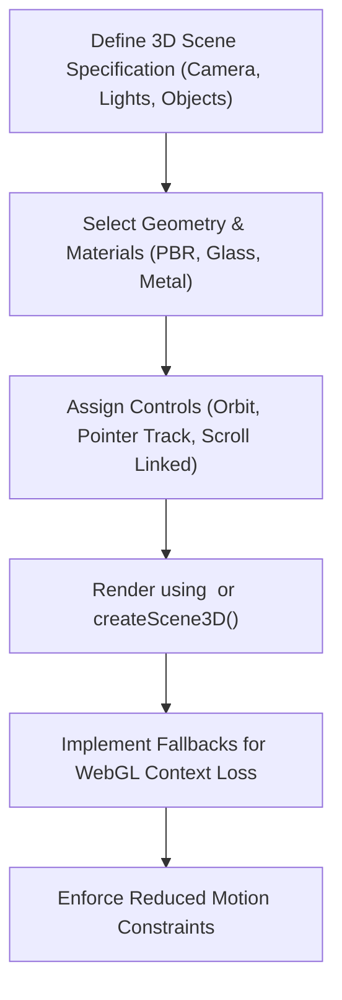

# 3D Scene Development

AF Motion provides a framework-independent 3D scene engine, camera and lighting controls, procedural geometry generators, GLTF asset lifecycles, and React 3D viewport bindings.

---

## 1. When to Use & When NOT to Use

### When to Use
- When embedding interactive 3D models or geometric compositions in React or web pages.
- When creating scroll-driven 3D camera movements and object rotations.
- When generating 3D scene specifications with `generate3DSceneFromIntent()`.
- When using procedural 3D primitives (spheres, cubes, toruses, rings) with PBR materials.
- When implementing pointer orbit, pan, zoom, and object raycast selection in 3D.

### When NOT to Use
- For flat 2D canvas particle fields or gradient backgrounds (use `graphics-effects`).
- For standard CSS transforms on HTML elements (use `react-animation` or `fundamentals`).

---

## 2. Step-by-Step Agent Workflow



1. **Construct Scene Specification**: Specify camera (perspective, FOV, initial position), lighting presets (studio, dramatic, ambient), and object definitions.
2. **Assign Materials & Geometry**: Use procedural geometry (`box`, `sphere`, `torus`) or define asset references to `.gltf` / `.glb` files.
3. **Configure Interactions**: Set orbit boundaries, damping, sensitivity, and click raycasting.
4. **Mount Viewport**: Use React's `<Scene3DCanvas>` for automatic canvas sizing, WebGL context lifecycle, and unmount disposal.
5. **Handle Graceful Degradation**: Always provide fallback lighting and low-poly primitives when running on mobile or integrated GPUs.

---

## 3. Core APIs & Scene Composition

### 3.1 React 3D Components

| Component | Subpath | Purpose |
| :--- | :--- | :--- |
| `<Scene3DCanvas>` | `af-motion/react` | Viewport container managing 3D render loop and resize observers |
| `<Scene3DObject>` | `af-motion/react` | Declarative 3D object representation inside `<Scene3DCanvas>` |

### 3.2 3D Scene Engine APIs

| API | Subpath | Purpose |
| :--- | :--- | :--- |
| `createScene3D(definition, opts)` | `af-motion/catalogue` | Instantiates framework-independent 3D scene instance |
| `generate3DSceneFromIntent(intent)`| `af-motion/catalogue` | AI generation pipeline creating validated 3D specifications |
| `detect3DCapabilities()` | `af-motion/catalogue` | Inspects WebGL/WebGPU support, max texture size, and extensions |

---

## 4. Copyable Implementation Examples

### Example A: Declarative React 3D Scene with Procedural Torus
```tsx
"use client";

import React from "react";
import { Scene3DView } from "af-motion/react";

export function Hero3DViewport() {
  return (
    <div className="w-full h-[500px] rounded-3xl overflow-hidden bg-neutral-950">
      <Scene3DView
        sceneDefinition={{
          id: "hero-viewport",
          objects: [
            {
              id: "hero-ring",
              geometry: { type: "torus", radius: 1.5, tube: 0.4 },
              material: { type: "pbr", color: "#6366f1", metalness: 0.85, roughness: 0.15 },
              position: [0, 0, 0],
            },
          ],
        }}
      />
    </div>
  );
}
```

### Example B: Programmatic AI 3D Scene Generation
```ts
import { generate3DSceneFromIntent, createScene3D } from "af-motion/catalogue";

// Generate complete validated 3D scene from high-level aesthetic intent
const result = generate3DSceneFromIntent(
  "Minimalist floating glass sphere with soft purple ambient lighting and metallic rings",
  { maxLights: 3 }
);

console.log("Resolved Spec Objects:", result.spec.objects.length);
console.log("Validation Status:", result.validationReport.valid);

// Instantiate scene onto canvas if in browser environment
const canvas = document.querySelector<HTMLCanvasElement>("#scene-canvas");
if (canvas) {
  const scene = createScene3D(result.spec, { canvas });
  scene.start();
}
```

---

## 5. Accessibility & Performance Best Practices

- **Damping and Reduced Motion**: When `prefers-reduced-motion` is detected, disable continuous object auto-rotation and limit camera travel to instant transitions.
- **Polycount Capping**: For mobile devices, procedural primitives should cap segment subdivisions (e.g. 16-24 segments instead of 64+).
- **WebGL Context Loss**: AF Motion provides automatic restoration listeners (`onContextLost`, `onContextRestored`) to prevent blank white screens if the GPU restarts.

---

## 6. Common Pitfalls & Troubleshooting

| Issue | Cause | Fix |
| :--- | :--- | :--- |
| Black screen inside canvas | Missing lights in custom scene | Ensure at least one directional or ambient light exists in `lighting`. |
| Memory leak when navigating away | Three.js geometries/textures not disposed | Use `<Scene3DCanvas>` which automatically calls `dispose()` on unmount. |

---

## 7. Related Skills
- [fundamentals](file:///skills/fundamentals/SKILL.md)
- [graphics-effects](file:///skills/graphics-effects/SKILL.md)
- [choreography-sync](file:///skills/choreography-sync/SKILL.md)
