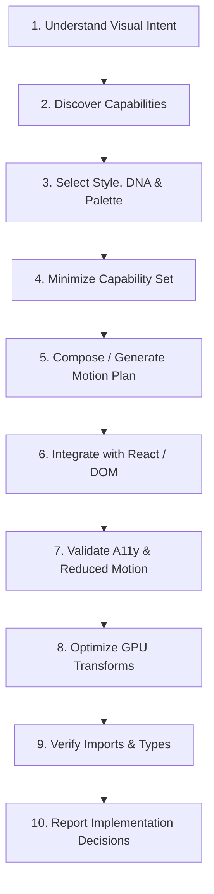

# AF Motion — Central Agent Skill

AF Motion is a high-performance, framework-independent motion engine with first-class React bindings, 19 visual design styles, 33 built-in palettes, 2D/3D graphics synchronization, and an AI-native Motion Intelligence system.

This skill serves as the primary router and orchestrator for AI coding agents.

---

## 1. When to Use & When NOT to Use

### When to Use
- When designing, generating, or implementing animations in web or React applications.
- When applying aesthetic visual styles (e.g. Glassmorphism, Neobrutalism, Cyberpunk, Skeuomorphism, Editorial).
- When orchestrating entrance, exit, page, or scroll-driven transitions.
- When creating microinteractions for buttons, inputs, toggles, and cards.
- When synchronizing DOM animations with Canvas 2D/WebGL graphics or 3D scenes.
- When auditing, optimizing, or validating existing animations for accessibility and performance.

### When NOT to Use
- When the user explicitly requests raw CSS transitions without library dependencies.
- For non-visual data manipulation or backend logic unrelated to motion.
- When using another third-party animation library (e.g. Framer Motion, GSAP) unless migrating to AF Motion.

---

## 2. Master Agent Workflow (10 Steps)

Every AI coding agent implementing motion with AF Motion MUST follow this deterministic workflow:



1. **Understand Visual Intent**: Determine the target element, user trigger (scroll, hover, tap, entrance, continuous), and desired aesthetic feel.
2. **Discover Capabilities**: Query AF Motion's AI Motion Registry or consult specialized skills rather than guessing APIs.
3. **Select Style, DNA & Palette**: Pick from the 19 Visual Styles (e.g. `minimal`, `glassmorphism`, `cyberpunk`) and 5 Motion DNA personalities (`energetic`, `playful`, `elegant`, `precise`, `editorial-flow`).
4. **Minimize Capability Set**: Use the simplest primitive that fulfills the requirement (e.g. `useInView` or `<ScrollReveal>` instead of complex custom timelines for basic reveals).
5. **Compose / Generate Motion Plan**: Use Animation Intelligence or microinteraction generators to calculate appropriate easing, duration, and stagger.
6. **Integrate Cleanly**: Place hooks and components into existing React trees without breaking layouts or altering unrelated state.
7. **Validate Accessibility**: Always support `prefers-reduced-motion` using `useReducedMotion()`, skip non-essential movement, and maintain WCAG contrast.
8. **Optimize Performance**: Animate only GPU-accelerated properties (`transform`, `opacity`, `filter`). Avoid animating layout properties (`width`, `height`, `top`, `margin`).
9. **Verify Imports & Types**: Import from appropriate subpaths (`af-motion`, `af-motion/react`, `af-motion/catalogue`, `af-motion/presets`). Run `tsc --noEmit`.
10. **Report Decisions**: Concisely summarize the selected Visual Style, Motion DNA, and accessibility fallbacks.

---

## 3. Skill Selection Matrix

Direct agents to the specialized skill corresponding to their task:

| Domain | Specialized Skill | Primary Capabilities Covered |
| :--- | :--- | :--- |
| **Foundations** | `[fundamentals](file:///skills/fundamentals/SKILL.md)` | Imports, subpaths, package architecture, API selection |
| **React UI** | `[react-animation](file:///skills/react-animation/SKILL.md)` | Hooks (`useAnimate`, `useScrollProgress`), `<Interactive />`, `<Reveal />`, SSR, Strict Mode |
| **AI Intelligence** | `[motion-intelligence](file:///skills/motion-intelligence/SKILL.md)` | Natural language interpretation, Motion DNA, Animation Decision Engine |
| **Design Systems** | `[visual-styles](file:///skills/visual-styles/SKILL.md)` | 19 visual styles, 33 palettes, design tokens, CSS variables |
| **Page & Scroll** | `[transitions-scroll](file:///skills/transitions-scroll/SKILL.md)` | Entrance/exit, page transitions, scroll reveals, sticky parallax |
| **Interactive UI** | `[interactive-components](file:///skills/interactive-components/SKILL.md)` | Button microinteractions, card tilt, input focus, spring physics |
| **Sequencing** | `[choreography-sync](file:///skills/choreography-sync/SKILL.md)` | Timelines, staggered grids, DOM + Graphics + 3D synchronization |
| **2D & Shader FX** | `[graphics-effects](file:///skills/graphics-effects/SKILL.md)` | Canvas backgrounds, fluid simulation, particles, glass materials |
| **3D Scenes** | `[3d-scene-development](file:///skills/3d-scene-development/SKILL.md)` | 3D scene engine, geometry, cameras, lighting, GLTF assets |
| **Diagnostics** | `[motion-validation](file:///skills/motion-validation/SKILL.md)` | Motion validation, accessibility compliance, config optimization |
| **AI Pipelines** | `[ai-generation](file:///skills/ai-generation/SKILL.md)` | Deterministic composition schemas, pipeline generation |
| **MCP Integration** | `[mcp-integration](file:///skills/mcp-integration/SKILL.md)` | Model Context Protocol server, tools, resources, prompts |

---

## 4. API Reference & Package Import Structure

AF Motion exports targeted subpaths to support clean tree-shaking:

```ts
// 1. Core Framework-Independent Primitives & Effects
import { animate, animateSpring, glow, tilt, easings } from "af-motion";

// 2. React Hooks & Components
import { useAnimate, useScrollProgress, Interactive, ScrollReveal } from "af-motion/react";

// 3. AI Motion Intelligence, Registries & MCP
import { aiMotionRegistry, visualStyleRegistry, recommendAnimation, createAFMotionMCPServer } from "af-motion/catalogue";

// 4. Curated Animation Presets
import { listPresets, applyPreset } from "af-motion/presets";
```

---

## 5. Accessibility & Reduced Motion Principles

All implementations generated by agents MUST adhere to AF Motion's accessibility standards:

- **Respect User Preferences**: Check `useReducedMotion()` or CSS media queries.
- **Graceful Fallbacks**: When reduced motion is active, replace spatial movement with instantaneous transitions, opacity fades, or static state.
- **Non-blocking Execution**: Ensure animations can be cancelled, interrupted, or skipped.
- **Focus Indicators**: Microinteractions must preserve or enhance keyboard focus visibility.

---

## 6. Related Skills
- [fundamentals](file:///skills/fundamentals/SKILL.md)
- [react-animation](file:///skills/react-animation/SKILL.md)
- [motion-validation](file:///skills/motion-validation/SKILL.md)
