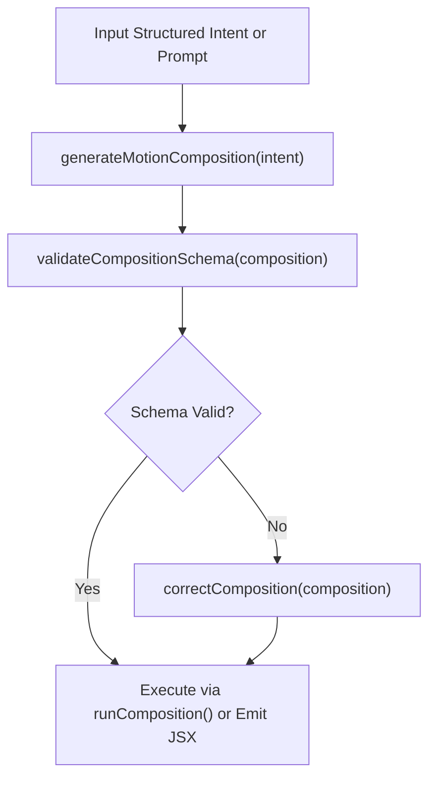

# AI-Native Generation & Composition Schemas

AF Motion features a deterministic generation pipeline that compiles high-level structured intents and aesthetic specifications into verified, capability-safe animation trees.

---

## 1. When to Use & When NOT to Use

### When to Use
- When generating complex multi-element compositions using machine-readable JSON schemas.
- When an AI agent needs to produce deterministic, reproducible motion plans from user specifications.
- When verifying that a generated composition adheres to AF Motion's unified composition schema.
- When automatically repairing invalid compositions prior to execution.

### When NOT to Use
- For simple one-off button microinteractions (use `interactive-components`).
- For standard React component authoring where direct JSX is preferred (use `react-animation`).

---

## 2. Step-by-Step Agent Workflow



1. **Construct Composition Intent**: Define target elements, visual styles, timing bounds, and required motion layers (DOM, canvas, 3D).
2. **Execute Generation Pipeline**: Call `generateMotionComposition()` to synthesize an immutable, fully articulated composition plan.
3. **Validate Schema**: Check `validateCompositionSchema()` ensuring all capability references and parameter values are legitimate.
4. **Deploy Composition**: Mount via AF Motion's composition runner or emit clean React JSX.

---

## 3. Core Composition Schemas & APIs

| API | Subpath | Purpose |
| :--- | :--- | :--- |
| `generateMotionComposition(spec)` | `af-motion/catalogue` | Compiles intent into structured multi-layer composition |
| `validateCompositionSchema(spec)` | `af-motion/catalogue` | Verifies composition against JSON schema definitions |
| `correctConfiguration(id, cfg)` | `af-motion/catalogue` | Repairs and normalizes out-of-bounds parameters |

---

## 4. Copyable Implementation Examples

### Example: Compiling & Validating a Multi-Layer Composition
```ts
import {
  createComposition,
  validateComposition,
} from "af-motion/catalogue";

// 1. Define structured intent
const intent = {
  style: "editorial",
  motionDNA: "editorial-flow",
  layers: [
    {
      type: "dom",
      target: "#hero-headline",
      animation: "fade-up",
      duration: 500,
    },
    {
      type: "background",
      effect: "aurora",
      palette: "nordic-frost",
    },
  ],
};

// 2. Generate composition plan
const composition = createComposition("hero-comp", { metadata: intent });

// 3. Validate against schema
const validation = validateComposition(composition);
if (validation.valid) {
  console.log("Composition verified and ready for rendering!");
  console.log("Total Steps:", composition.steps.length);
} else {
  console.error("Validation failed:", validation.errors);
}
```

---

## 5. Accessibility & Performance Best Practices

- **Deterministic Outputs**: Compositions generated with the same seed or parameters must produce identical timings and curves.
- **Fail-Safe Fallbacks**: If an unrecognized effect is requested in a composition layer, the pipeline automatically substitutes a graceful fallback (e.g. replacing WebGL fluid with a soft CSS gradient).
- **Reduced Motion Flag**: Every generated composition object contains a `reducedMotion` strategy field.

---

## 6. Common Pitfalls & Troubleshooting

| Issue | Cause | Fix |
| :--- | :--- | :--- |
| Schema validation fails on custom properties | Extra unknown properties passed into layer specs | Strip unrecognized fields before passing into `generateMotionComposition()`. |

---

## 7. Related Skills
- [fundamentals](file:///skills/fundamentals/SKILL.md)
- [motion-intelligence](file:///skills/motion-intelligence/SKILL.md)
- [motion-validation](file:///skills/motion-validation/SKILL.md)
