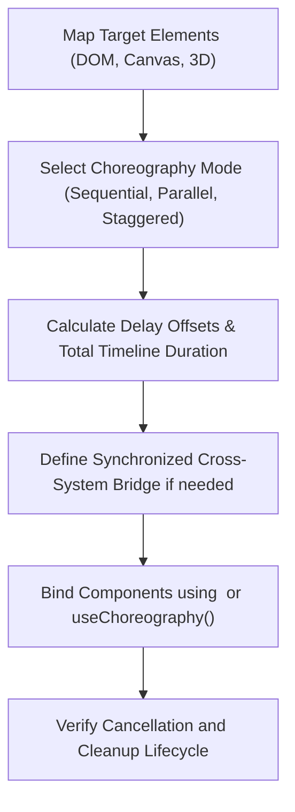

# Choreography & Multi-System Synchronization

AF Motion provides unified timeline orchestration that coordinates complex multi-element sequences across DOM elements, 2D Canvas graphics, and WebGL 3D scenes.

---

## 1. When to Use & When NOT to Use

### When to Use
- When timing sequences where element B must animate after element A completes.
- When orchestrating parallel or overlapping animations across multiple UI elements.
- When animating a DOM text overlay in exact synchrony with a background 2D particle explosion or 3D camera move.
- When generating declarative choreography trees using `<Choreography>` and `<ChoreographyGroup>`.
- When using `generateChoreographyPlan()` to compute deterministic stagger and delay offsets.

### When NOT to Use
- For isolated single-element hover states (use `interactive-components`).
- For standalone scroll reveals with independent triggers (use `transitions-scroll`).

---

## 2. Step-by-Step Agent Workflow



1. **Map Participants**: Identify which elements are involved (DOM headers, cards, background canvas, 3D model).
2. **Select Orchestration Mode**:
   - `sequence`: Steps execute one after another in order.
   - `parallel`: Steps execute concurrently with independent duration and delay.
   - `stagger`: A repeating sequence offset by uniform intervals (e.g. 60ms between cards).
3. **Handle Cross-System Bridges**:
   - When bridging DOM and 3D, use `useSynchronizedMotion()` to route a single timeline progress value [0, 1] to both DOM CSS transforms and 3D camera/object parameters.
4. **Lifecycle & Cancellation**: Ensure that calling `cancel()` or unmounting the root container safely stops all participant animations.

---

## 3. Core APIs & Synchronization Primitives

### 3.1 React Components & Hooks

| API | Subpath | Purpose |
| :--- | :--- | :--- |
| `<Choreography>` | `af-motion/react` | Container managing child animation step execution |
| `<ChoreographyGroup>` | `af-motion/react` | Groups staggered items within a larger sequence |
| `useChoreography(steps, opts)` | `af-motion/react` | Imperative timeline controls (`play`, `pause`, `seek`, `cancel`) |
| `useSynchronizedMotion(opts)` | `af-motion/react` | Synchronizes progress across DOM, Canvas, and 3D targets |

### 3.2 Catalogue Intelligence APIs

| API | Subpath | Purpose |
| :--- | :--- | :--- |
| `generateChoreographyPlan(req)` | `af-motion/catalogue` | Computes step delays, durations, and dependencies |
| `classifyChoreographyIntent(text)`| `af-motion/catalogue` | Detects cross-system synchronization keywords (`dom`, `graphics`, `3d`) |

---

## 4. Copyable Implementation Examples

### Example A: Staggered Multi-Element Entrance
```tsx
"use client";

import React from "react";
import { Choreography, ChoreographyGroup, Reveal } from "af-motion/react";

export function HeroSequence() {
  return (
    <Choreography mode="sequence" delay={150}>
      {/* Step 1: Badge Entrance */}
      <Reveal effect="fade-down" duration={300}>
        <span className="badge">v2.0 Release</span>
      </Reveal>

      {/* Step 2: Main Title Entrance */}
      <Reveal effect="fade-up" duration={450}>
        <h1 className="text-5xl font-black">Spatial Motion Engine</h1>
      </Reveal>

      {/* Step 3: Staggered Action Buttons */}
      <ChoreographyGroup staggerMs={80}>
        <button className="btn-primary">Get Started</button>
        <button className="btn-secondary">View Documentation</button>
      </ChoreographyGroup>
    </Choreography>
  );
}
```

### Example B: DOM + 3D Scene Synchronized Transition
```tsx
"use client";

import React, { useRef } from "react";
import { useSynchronizedMotion } from "af-motion/react";

export function SynchronizedShowcase() {
  const domHeadingRef = useRef<HTMLHeadingElement>(null);
  const sceneRotation = useRef({ x: 0, y: 0 });

  const { play, progress } = useSynchronizedMotion({
    duration: 800,
    targets: {
      dom: [
        {
          target: domHeadingRef,
          keyframes: { opacity: [0, 1], transform: ["scale(0.9)", "scale(1)"] },
        },
      ],
      custom: [
        {
          onUpdate: (p) => {
            // Synchronize 3D object rotation simultaneously
            sceneRotation.current.y = p * Math.PI;
          },
        },
      ],
    },
  });

  return (
    <div className="showcase-container">
      <h2 ref={domHeadingRef} className="text-3xl font-bold">Synchronized Motion</h2>
      <button onClick={() => play()} className="play-btn">Animate Both Systems</button>
      <p className="text-sm">Progress: {Math.round(progress * 100)}%</p>
    </div>
  );
}
```

---

## 5. Accessibility & Performance Best Practices

- **Total Sequence Budget**: Keep complete entrance choreographies under 1,200ms total duration so users aren't left waiting for interactive content.
- **Cancel on Page Navigation**: Cancel running timelines on component unmount to prevent attempting to animate detached DOM nodes.
- **Reduced Motion Coalescing**: Under reduced motion, collapse all delays to 0ms and trigger instant endpoint rendering.

---

## 6. Common Pitfalls & Troubleshooting

| Issue | Cause | Fix |
| :--- | :--- | :--- |
| Subsequent steps not firing | Preceding step threw an error or duration was set to `Infinity` | Ensure all keyframe steps have finite durations. |
| Stagger lag on large lists (> 50 items) | Too many simultaneous active animations | Cap stagger count to visible viewport items or batch in groups of 10. |

---

## 7. Related Skills
- [fundamentals](file:///skills/fundamentals/SKILL.md)
- [react-animation](file:///skills/react-animation/SKILL.md)
- [3d-scene-development](file:///skills/3d-scene-development/SKILL.md)
