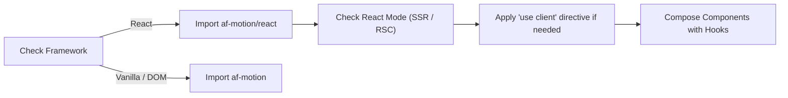

# AF Motion Fundamentals

This skill guides AI agents through initial setup, architectural layering, API selection, and package import structures in AF Motion.

---

## 1. When to Use & When NOT to Use

### When to Use
- When setting up AF Motion in a new or existing repository.
- When determining which subpath import to use (`af-motion`, `af-motion/react`, `af-motion/catalogue`, `af-motion/presets`).
- When deciding whether a task requires the framework-independent Core API, React bindings, 2D Graphics Canvas, or the 3D Engine.
- When configuring TypeScript declarations or bundler tree-shaking.

### When NOT to Use
- When building complex React component trees (use `react-animation`).
- When configuring 3D scenes or Three.js adapters (use `3d-scene-development`).
- When setting up AI server tools via MCP (use `mcp-integration`).

---

## 2. API Selection Guide

AF Motion is architected into 4 distinct layers. Choose the lowest layer that meets your functional requirement:

| Layer | Subpath | When to Choose | Examples |
| :--- | :--- | :--- | :--- |
| **Core Animation** | `af-motion` | Direct DOM manipulation, vanilla JS/TS, micro-libraries, canvas render loops, or custom UI engines. Zero React dependency. | `animate()`, `animateSpring()`, `tilt()`, `magnetic()`, `gradientBackground()` |
| **React Integration** | `af-motion/react` | Modern React 18/19 applications, Next.js (App & Pages router), SSR, React Server Components boundaries. | `useAnimate()`, `<Reveal>`, `<Interactive>`, `<ScrollReveal>`, `useMicrointeraction()` |
| **AI & Metadata** | `af-motion/catalogue` | Discovering capabilities, querying design tokens, natural-language prompt interpretation, motion validation. | `aiMotionRegistry`, `visualStyleRegistry`, `recommendAnimation()`, `validateMotionConfig()` |
| **Curated Presets** | `af-motion/presets` | Standardized, battle-tested animation recipes with zero manual tuning. | `runPreset()`, `listPresets()`, `exportPresetDocument()` |

---

## 3. Step-by-Step Agent Workflow



1. **Verify Environment**: Identify if the project is React or vanilla JS/TS.
2. **Select Import Subpath**:
   - For React hooks and components: `import { useAnimate, Reveal } from "af-motion/react";`
   - For core animation and effects: `import { animate, easings } from "af-motion";`
   - For registries and AI tools: `import { aiMotionRegistry } from "af-motion/catalogue";`
3. **Respect Module Boundaries**:
   - In Next.js App Router, any component using `af-motion/react` hooks or interactive elements must include `"use client";` at the top of the file.
   - Core catalogue schemas in `af-motion/catalogue` are pure data structures safe for React Server Components (RSC).
4. **Configure TypeScript**: Ensure `tsconfig.json` has `"moduleResolution": "Bundler"` or `"NodeNext"`.

---

## 4. API Reference & Code Examples

### Example A: Core DOM Animation (Framework-Independent)
```ts
import { animate, easings } from "af-motion";

const button = document.querySelector<HTMLButtonElement>("#cta-button");

if (button) {
  const controls = animate({
    target: button,
    keyframes: {
      transform: ["translateY(0px) scale(1)", "translateY(-4px) scale(1.02)"],
      boxShadow: ["0px 4px 12px rgba(0,0,0,0.1)", "0px 12px 24px rgba(0,0,0,0.15)"],
    },
    duration: 350,
    easing: easings.easeOutCubic,
    onComplete: () => console.log("Animation finished"),
  });

  // Cancel if needed
  // controls.cancel();
}
```

### Example B: React Hook Implementation
```tsx
"use client";

import React, { useRef } from "react";
import { useAnimate } from "af-motion/react";
import { easings } from "af-motion";

export function HeroCard({ title, children }: { title: string; children: React.ReactNode }) {
  const cardRef = useRef<HTMLDivElement>(null);

  const { isAnimating, cancel } = useAnimate(cardRef, {
    keyframes: {
      opacity: [0, 1],
      transform: ["translateY(24px)", "translateY(0px)"],
    },
    duration: 450,
    easing: easings.easeOutQuad,
  });

  return (
    <div ref={cardRef} className="card">
      <h2>{title}</h2>
      {children}
    </div>
  );
}
```

---

## 5. Accessibility & Performance Best Practices

- **GPU Acceleration**: Always prefer `transform` (`translate`, `scale`, `rotate`) and `opacity` over properties like `top`, `left`, `width`, `height`, or `margin`.
- **Reduced Motion**: Always honor system settings. In `af-motion/react`, `useReducedMotion()` automatically detects accessibility preferences.
- **Tree-Shaking**: Ensure you import named exports rather than wildcard imports (`import * as AF from "af-motion"`) to allow bundlers to prune unused shaders and effects.

---

## 6. Common Pitfalls & Troubleshooting

| Issue | Cause | Fix |
| :--- | :--- | :--- |
| `TypeError: window is not defined` | Accessing DOM during SSR in Next.js | Add `"use client";` to the file or wrap effect inside `useEffect()`. |
| Layout thrashing / stutter | Animating `height`, `width`, or `top` | Use `transform: scaleY(...)` or `transform: translateY(...)`. |
| Unused code included in bundle | Wildcard importing entire library | Import specific functions directly from `af-motion` or `af-motion/react`. |

---

## 7. Related Skills
- [af-motion](file:///skills/af-motion/SKILL.md)
- [react-animation](file:///skills/react-animation/SKILL.md)
- [motion-validation](file:///skills/motion-validation/SKILL.md)
