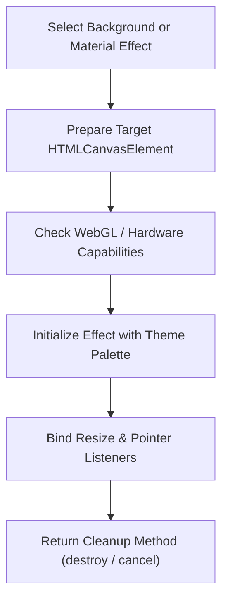

# Graphics & Visual Effects

AF Motion provides hardware-accelerated 2D canvas effects, procedural shader pipelines, fluid simulations, and responsive ambient backgrounds with automatic fallback strategies.

---

## 1. When to Use & When NOT to Use

### When to Use
- When generating ambient background effects (Aurora, Cosmic stars, Floating orbs, Particle fields, Animated mesh gradients, Grid waves, Noise).
- When rendering glass refraction, specular highlights, and chromatic dispersion.
- When creating interactive pointer-reactive canvas surfaces (particle attraction, ripple waves).
- When building immersive landing page hero backdrops.

### When NOT to Use
- For standard UI component layout styling (use `visual-styles`).
- When full 3D object rendering with mesh geometry, cameras, and lighting is required (use `3d-scene-development`).

---

## 2. Background Effects Catalog

| Effect Function | Type | Visual Outcome |
| :--- | :--- | :--- |
| `auroraBackground(canvas, opts)` | Canvas 2D / Shader | Flowing northern-lights curtain waves with dynamic color blending |
| `cosmicBackground(canvas, opts)` | Canvas 2D | Multi-depth starry galaxy with twinkling stars and nebulae |
| `floatingOrbsBackground(canvas, opts)`| Canvas 2D | Soft, blurred glowing spheres drifting and repelling one another |
| `particleFieldBackground(canvas, opts)`| Canvas 2D | Interconnected constellation particles reacting to mouse position |
| `waveBackground(canvas, opts)` | Canvas 2D | Harmonic sine wave ribbons with gradient fills |
| `gridBackground(canvas, opts)` | Canvas 2D | Perspective grid with undulating pulse waves |
| `noiseBackground(canvas, opts)` | Canvas 2D / Shader | Procedural Perlin/Simplex film grain and fluid organic texture |
| `fluidBackground(canvas, opts)` | WebGL / Canvas 2D | Navigating fluid dynamics with viscosity and velocity vortices |

---

## 3. Step-by-Step Agent Workflow



1. **Allocate Canvas**: Create or reference a clean `<canvas>` element sized to full container width/height.
2. **Capability Detection**: AF Motion graphics automatically detect WebGL2, WebGL1, or Canvas 2D context availability and downgrade seamlessly.
3. **Configure Options**: Specify particle counts, colors, speeds, and whether the canvas should track pointer interactions.
4. **Lifecycle Management**: Always call `controls.destroy()` or clean up on component unmount to terminate render loops and release GPU texture buffers.

---

## 4. API Reference & Code Examples

### Example A: Aurora Background Canvas in React
```tsx
"use client";

import React, { useEffect, useRef } from "react";
import { aurora } from "af-motion";

export function HeroAuroraBackdrop() {
  const canvasRef = useRef<HTMLCanvasElement>(null);

  useEffect(() => {
    const canvas = canvasRef.current;
    if (!canvas) return;

    // Initialize flowing aurora background
    const controls = aurora({
      canvas,
      colors: ["#3b82f6", "#8b5cf6", "#ec4899"], // Blue, Purple, Pink
      speed: 0.8,
      intensity: 1.2,
      interactive: true,
    });

    return () => {
      // Clean up render loop and detach listeners
      controls.destroy();
    };
  }, []);

  return (
    <div className="relative w-full h-[600px] overflow-hidden bg-neutral-950">
      <canvas ref={canvasRef} className="absolute inset-0 w-full h-full" />
      <div className="relative z-10 flex items-center justify-center h-full text-white">
        <h1 className="text-5xl font-black">Next-Gen Experiences</h1>
      </div>
    </div>
  );
}
```

### Example B: Interactive Constellation Particle Field
```tsx
"use client";

import React, { useEffect, useRef } from "react";
import { particleField } from "af-motion";

export function ConstellationHeader() {
  const canvasRef = useRef<HTMLCanvasElement>(null);

  useEffect(() => {
    if (!canvasRef.current) return;

    const controls = particleField({
      canvas: canvasRef.current,
      particleCount: 80,
      connectionDistance: 120,
      particleColor: "rgba(255, 255, 255, 0.7)",
      lineColor: "rgba(255, 255, 255, 0.15)",
      speedMultiplier: 0.6,
      interactive: true, // Particles react to mouse hover
    });

    return () => controls.destroy();
  }, []);

  return (
    <canvas
      ref={canvasRef}
      className="w-full h-80 bg-neutral-900 rounded-2xl block"
    />
  );
}
```

---

## 5. Accessibility & Performance Best Practices

- **Frame Rate Budgeting**: Canvas loops are clamped to `requestAnimationFrame`. If the window drops below 30 FPS, particle counts should be throttled automatically.
- **Offscreen Canvas & Device Pixel Ratio**: AF Motion automatically scales for Retina displays (`window.devicePixelRatio`), capped at 2x to avoid GPU memory saturation on 4K/5K displays.
- **Reduced Motion Behavior**: When `prefers-reduced-motion` is detected, speed multipliers drop to 0 or render a static frame.

---

## 6. Common Pitfalls & Troubleshooting

| Issue | Cause | Fix |
| :--- | :--- | :--- |
| Canvas looks blurry or pixelated | Canvas `width`/`height` attribute does not match CSS display size | Let AF Motion manage canvas resolution internally or call `controls.resize()`. |
| CPU spikes after component unmounts | Missing cleanup function call in `useEffect` | Always return `() => controls.destroy()` from your effect hook. |

---

## 7. Related Skills
- [fundamentals](file:///skills/fundamentals/SKILL.md)
- [visual-styles](file:///skills/visual-styles/SKILL.md)
- [3d-scene-development](file:///skills/3d-scene-development/SKILL.md)
