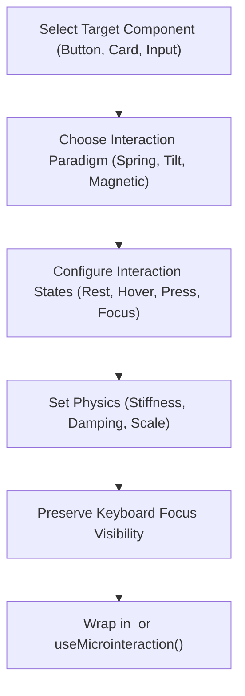

# Interactive Components & Microinteractions

AF Motion provides physics-driven interaction primitives for web interfaces, including spring hover responses, 3D perspective tilt, magnetic cursor attraction, and accessible focus treatments.

---

## 1. When to Use & When NOT to Use

### When to Use
- When building tactile buttons with spring depress and hover states.
- When adding 3D tilt and specular lighting to cards (`useTilt`, `tilt`).
- When creating magnetic elements attracted to the pointer cursor (`useMagnetic`, `magnetic`).
- When designing accessible form inputs with animated focus rings or active validation states.
- When generating context-aware microinteraction plans with `generateMicrointeractionPlan()`.

### When NOT to Use
- For long-running scene choreographies (use `choreography-sync`).
- For viewport entrance reveals (use `transitions-scroll`).
- For global page layout transitions (use `transitions-scroll`).

---

## 2. Step-by-Step Agent Workflow



1. **Identify the Component Type**: Button, icon button, card, input field, switch/toggle, or tab.
2. **Choose Interaction Paradigm**:
   - Buttons: Spring press feedback (`scale: 0.96`), optional subtle lift on hover (`scale: 1.02`).
   - Cards: 3D perspective tilt with specular highlight or shadow depth increase.
   - Hero CTA: Magnetic attraction tracking cursor coordinates within a threshold radius.
3. **Configure States**: Ensure distinct visual treatments for `rest`, `hover`, `active` (press), and `focus-visible`.
4. **Enforce Accessibility**: Always retain high-contrast focus rings for keyboard users navigating via Tab.

---

## 3. Core APIs & Component Primitives

### 3.1 Components

| Component | Description | Key Props |
| :--- | :--- | :--- |
| `<Interactive>` | Spring hover/press wrapper | `scale={1.03}`, `pressScale={0.96}`, `glow={true}` |
| `<Interactive>` | 3D tilt and glare card surface | `maxTilt={12}`, `glare={true}`, `perspective={1000}` |

### 3.2 Hooks & Utilities

| API | Subpath | Purpose |
| :--- | :--- | :--- |
| `useMicrointeraction(ref, config)` | `af-motion/react` | Unified hook managing hover, press, focus, and state transitions |
| `useTilt(ref, options)` | `af-motion/react` | Tracks pointer position and computes 3D rotateX/rotateY transforms |
| `useMagnetic(ref, options)` | `af-motion/react` | Pulls element toward the pointer cursor when within radius |
| `generateMicrointeractionPlan(req)`| `af-motion/catalogue` | Generates spring curves and transform values based on component type |

---

## 4. Copyable Implementation Examples

### Example A: Magnetic CTA Button with Spring Depress
```tsx
"use client";

import React, { useRef } from "react";
import { useMicrointeraction, Interactive } from "af-motion/react";

export function MagneticCTA({ label, onClick }: { label: string; onClick: () => void }) {
  const buttonRef = useRef<HTMLButtonElement>(null);

  // Spring hover and active press response
  useMicrointeraction(buttonRef, {
    category: "button",
    hover: { scale: 1.05, duration: 200 },
    press: { scale: 0.94, duration: 100 },
  });

  return (
    <button
      ref={buttonRef}
      onClick={onClick}
      className="px-8 py-4 bg-indigo-600 text-white rounded-full font-bold shadow-lg hover:shadow-indigo-500/50 transition-shadow outline-none focus-visible:ring-4 focus-visible:ring-indigo-300"
    >
      {label}
    </button>
  );
}
```

### Example B: 3D Interactive Tilt Card with Glare
```tsx
"use client";

import React from "react";
import { Interactive } from "af-motion/react";

export function TiltFeatureCard({ title, desc }: { title: string; desc: string }) {
  return (
    <InteractiveSurface
      maxTilt={10}
      glare={true}
      glareOpacity={0.15}
      className="p-8 bg-neutral-900 border border-neutral-800 rounded-2xl text-white shadow-xl cursor-pointer"
    >
      <div className="card-body">
        <h3 className="text-xl font-bold mb-2">{title}</h3>
        <p className="text-neutral-400 text-sm leading-relaxed">{desc}</p>
      </div>
    </Interactive>
  );
}
```

### Example C: Animated Toggle Switch with Spring Indicator
```tsx
"use client";

import React, { useRef } from "react";
import { useAnimate } from "af-motion/react";
import { easings } from "af-motion";

export function Switch({ checked, onChange }: { checked: boolean; onChange: (val: boolean) => void }) {
  const thumbRef = useRef<HTMLSpanElement>(null);

  useAnimate(thumbRef, {
    keyframes: {
      transform: checked ? ["translateX(2px)", "translateX(22px)"] : ["translateX(22px)", "translateX(2px)"],
    },
    duration: 220,
    easing: easings.easeOutBack,
  });

  return (
    <button
      role="switch"
      aria-checked={checked}
      onClick={() => onChange(!checked)}
      className={`w-12 h-7 rounded-full p-0.5 transition-colors ${checked ? "bg-indigo-600" : "bg-neutral-700"}`}
    >
      <span ref={thumbRef} className="block w-6 h-6 bg-white rounded-full shadow-md" />
    </button>
  );
}
```

---

## 5. Accessibility & Performance Best Practices

- **Touch Device Detection**: On touchscreens or mobile viewports where mouse hover does not exist, disable `useMagnetic` and `useTilt` to avoid erratic jumpiness.
- **Focus Ring Preservation**: Never set `outline: none` without providing an equivalent `focus-visible` ring.
- **Reduced Motion**: Under reduced motion, replace scale springs with simple color or border-color shifts.

---

## 6. Common Pitfalls & Troubleshooting

| Issue | Cause | Fix |
| :--- | :--- | :--- |
| Magnetic button jerks when cursor leaves | Radius set too small or strength too high | Use `radius >= 80px` and `strength <= 0.4` for natural settling. |
| Tilt card clips text | Perspective origin mismatch | Set `transform-style: preserve-3d` on container and give text `translateZ(20px)`. |

---

## 7. Related Skills
- [fundamentals](file:///skills/fundamentals/SKILL.md)
- [react-animation](file:///skills/react-animation/SKILL.md)
- [motion-validation](file:///skills/motion-validation/SKILL.md)
