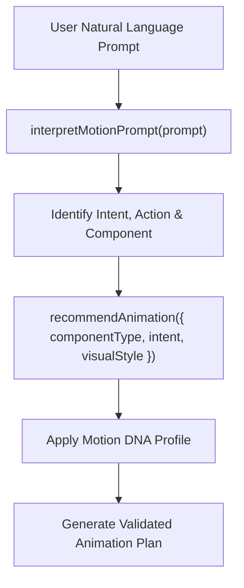

# Motion Intelligence & Decision Engine

AF Motion includes an AI-native decision engine that translates high-level aesthetic intent, component context, and natural-language prompts into deterministic, validated animation configurations.

---

## 1. When to Use & When NOT to Use

### When to Use
- When converting user prompts (e.g. "make the pricing card pop on click") into precise spring curves, durations, and keyframes.
- When selecting motion personalities using Motion DNA (`energetic`, `playful`, `elegant`, `precise`, `editorial-flow`).
- When determining the optimal animation family and easing curve for unfamiliar components.
- When an AI agent needs programmatic explanations of why a particular curve or duration was chosen.

### When NOT to Use
- For simple static CSS animations where exact timing is already known.
- For low-level canvas pixel manipulation (use `graphics-effects`).
- When running predefined presets without customization (use `af-motion/presets`).

---

## 2. Motion DNA Personalities

Motion DNA defines characteristic timing, easing curves, and physics across an application:

| Profile | Target Aesthetic | Characteristics | Damping / Stiffness |
| :--- | :--- | :--- | :--- |
| `precise` | Enterprise, SaaS, Dashboards | Rapid, snappy, zero overshoot, functional clarity | High damping (30), stiffness (300) |
| `playful` | Consumer apps, Games, Creative | Bouncy, expressive overshoot, dynamic rhythm | Low damping (12), stiffness (180) |
| `elegant` | Luxury, Portfolios, Editorial | Smooth deceleration, subtle transforms, long eases | High damping (26), stiffness (120) |
| `energetic` | High-impact landing pages, Web3 | Quick attack, moderate bounce, vibrant feedback | Moderate damping (18), stiffness (240) |
| `editorial-flow`| Digital magazines, Longform | Seamless continuous scrolling, relaxed inertia | Custom cubic-bezier easing curves |

---

## 3. Step-by-Step Agent Workflow



1. **Parse Prompt**: Pass natural language to `interpretMotionPrompt()`.
2. **Inspect Decision**: Review returned intent (`entrance`, `hover`, `click-interaction`, `scroll-reveal`).
3. **Recommend Optimal Config**: Call `recommendAnimation()` with the target component type and desired visual style.
4. **Apply Motion DNA**: Resolve physics parameters (stiffness, damping, duration multiplier) from the selected profile.
5. **Execute or Emit**: Feed the resulting parameters into `useAnimate()`, `<Interactive />`, or `animate()`.

---

## 4. API Reference & Code Examples

### Example A: Natural Language Prompt Interpretation
```ts
import { interpretMotionPrompt } from "af-motion/catalogue";

const result = interpretMotionPrompt("Make the modal dialogue zoom in smoothly from center with subtle bounce");

console.log("Action:", result.intent.action); // e.g. "entrance" or "scale"
console.log("Confidence:", result.confidence);
console.log("Recommended Duration:", result.configuration?.duration);
console.log("Recommended Easing:", result.configuration?.easing);
```

### Example B: Component-Aware Animation Recommendation
```ts
import { recommendAnimation } from "af-motion/catalogue";

const recommendation = recommendAnimation({
  componentType: "card",
  intent: "hover",
  visualStyle: "glassmorphism",
  motionDNA: "playful",
});

console.log("Selected Family:", recommendation.family);
console.log("Easing Curve:", recommendation.easing);
console.log("Duration (ms):", recommendation.duration);
console.log("Explanation:", recommendation.reasoning);
```

### Example C: React Integration with Motion DNA
```tsx
"use client";

import React, { useRef } from "react";
import { useAnimate } from "af-motion/react";
import { resolveMotionDNA } from "af-motion/catalogue";

export function DNABoundButton({ label }: { label: string }) {
  const buttonRef = useRef<HTMLButtonElement>(null);
  const dna = resolveMotionDNA("energetic");

  const { restart } = useAnimate(buttonRef, {
    keyframes: {
      transform: ["scale(1)", "scale(0.95)", "scale(1.02)", "scale(1)"],
    },
    duration: Math.round(300 * (dna?.timingMultiplier ?? 1)),
    easing: "cubic-bezier(0.34, 1.56, 0.64, 1)", // playful spring curve
  });

  return (
    <button ref={buttonRef} onClick={() => restart()} className="cta-button">
      {label}
    </button>
  );
}
```

---

## 5. Accessibility & Performance Best Practices

- **Adaptive Duration**: In high-density interfaces (tables, data grids), select the `precise` DNA profile to keep durations under 200ms.
- **Physics Bounds**: Ensure spring stiffness does not exceed 500 and damping does not fall below 8 to avoid erratic oscillations or visual jitter.
- **Accessibility Fallbacks**: If `prefers-reduced-motion` is active, the decision engine automatically replaces scale/movement curves with instantaneous opacity changes.

---

## 6. Common Pitfalls & Troubleshooting

| Issue | Cause | Fix |
| :--- | :--- | :--- |
| Low confidence on prompt interpretation | Ambiguous or keyword-sparse prompt | Include the target component type and trigger (e.g. "button hover", "dialog entrance"). |
| Overshoot causing clipping | Bouncy spring inside an `overflow: hidden` parent | Use the `precise` profile or add sufficient padding to the container. |

---

## 7. Related Skills
- [fundamentals](file:///skills/fundamentals/SKILL.md)
- [visual-styles](file:///skills/visual-styles/SKILL.md)
- [motion-validation](file:///skills/motion-validation/SKILL.md)
