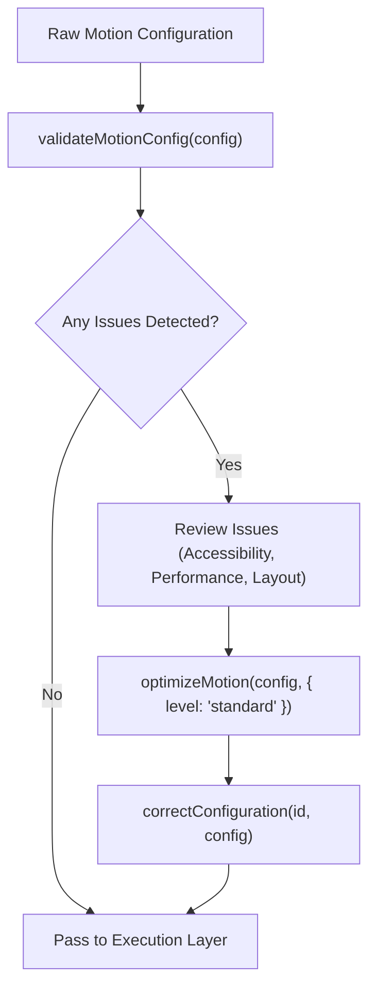

# Motion Validation & Optimization

AF Motion includes an automated diagnostic, validation, and optimization suite that analyzes animation configurations, detects performance and accessibility defects, and automatically optimizes them without altering visual intent.

---

## 1. When to Use & When NOT to Use

### When to Use
- When auditing an animation configuration before production deployment.
- When fixing layout-triggering properties (`width`, `height`, `top`, `left`, `margin`) and migrating them to GPU transforms (`translate`, `scale`).
- When checking compliance with `prefers-reduced-motion` and WCAG 2.3.3 / 2.3.1 (flashing rate limits).
- When clamping uncomfortably long durations (> 2,000ms) or negative delays.
- When rendering real-time performance HUDs in development using `<MotionDiagnostics>`.

### When NOT to Use
- When authoring new motion from scratch (use `react-animation` or `motion-intelligence`).
- When validating non-motion TypeScript schemas unrelated to AF Motion.

---

## 2. Step-by-Step Agent Workflow



1. **Run Validation**: Call `validateMotionConfig(config)`.
2. **Inspect Issue Report**: Check `issues` array for severity (`error`, `warning`, `info`) and category (`layout-thrashing`, `accessibility-risk`, `excessive-duration`, `timing-conflict`).
3. **Apply Optimization**: Run `optimizeMotion(config, { level: "standard" })` to replace layout properties with transforms and enforce sane timing bounds.
4. **Sanitize Parameters**: Run `correctConfiguration(capabilityId, config)` to ensure numbers are within allowed ranges and types match schemas.
5. **Verify Diagnostics in Dev**: Mount `<MotionDiagnostics />` during development to observe real-time FPS and active frame subscriptions.

---

## 3. Core APIs & Diagnostic Components

### 3.1 Validation & Optimization Functions

| API | Subpath | Purpose |
| :--- | :--- | :--- |
| `validateMotionConfig(config)` | `af-motion/catalogue` | Returns `{ valid, score, issues, summary }` |
| `optimizeMotion(config, opts)` | `af-motion/catalogue` | Automatically converts layout props and bounds timings |
| `correctConfiguration(id, cfg)`| `af-motion/catalogue` | Sanitizes invalid parameters into safe schema-compliant values |

### 3.2 React Diagnostic Components

| Component | Subpath | Purpose |
| :--- | :--- | :--- |
| `<MotionDiagnostics />` | `af-motion/react` | Floating developer HUD showing active animations and FPS |
| `useMotionDiagnostics()` | `af-motion/react` | Hook retrieving real-time frame scheduler statistics |

---

## 4. Copyable Implementation Examples

### Example A: Auditing & Auto-Optimizing Animation Configs
```ts
import { validateMotionConfig, optimizeMotion } from "af-motion/catalogue";

// Sub-optimal config with layout-thrashing property and excessive duration
const flawedConfig = {
  duration: 3500, // Too slow (> 2,000ms)
  width: ["100px", "300px"], // Layout property!
  opacity: [0, 1],
};

// 1. Validate
const report = validateMotionConfig(flawedConfig);
console.log("Valid:", report.valid); // false
console.log("Issues:", report.issues);

// 2. Automatically Optimize
const optimized = optimizeMotion(flawedConfig, {
  level: "standard",
  enforceGPUTransforms: true,
  maxDurationMs: 1200,
});

console.log("Optimized Config:", optimized.optimizedConfig);
// -> Replaces `width` with `transform: scaleX(...)`, clamps duration to 1200ms
```

### Example B: React Development Diagnostics HUD
```tsx
"use client";

import React from "react";
import { MotionDiagnostics } from "af-motion/react";

export function AppLayout({ children }: { children: React.ReactNode }) {
  const isDev = process.env.NODE_ENV === "development";

  return (
    <div className="app-container">
      {children}
      {/* Floating telemetry HUD for active animations, memory, and frame rates */}
      {isDev && <MotionDiagnostics position="bottom-right" expanded={false} />}
    </div>
  );
}
```

---

## 5. Accessibility & Performance Checklist

- [ ] **No Layout Triggers**: No animations on `width`, `height`, `top`, `bottom`, `left`, `right`, `margin`, or `padding`.
- [ ] **WCAG 2.3.1 Flashing Limit**: No element toggles opacity or color more than 3 times within 1 second.
- [ ] **Reduced Motion Alternative**: Motion either reduces duration to 0ms or falls back to an opacity crossfade.
- [ ] **Duration Ceiling**: Microinteractions must be <= 300ms; page transitions <= 500ms; multi-element choreographies <= 1,200ms.

---

## 6. Common Pitfalls & Troubleshooting

| Issue | Cause | Fix |
| :--- | :--- | :--- |
| `validateMotionConfig` flags `layout-thrashing` | `top` or `left` used for positioning animation | Change to `transform: translateY(...)` or `transform: translateX(...)`. |
| `accessibility-risk` warning | Continuous loop without reduced motion branch | Add reduced motion fallback checking `useReducedMotion()`. |

---

## 7. Related Skills
- [fundamentals](file:///skills/fundamentals/SKILL.md)
- [motion-intelligence](file:///skills/motion-intelligence/SKILL.md)
- [react-animation](file:///skills/react-animation/SKILL.md)
