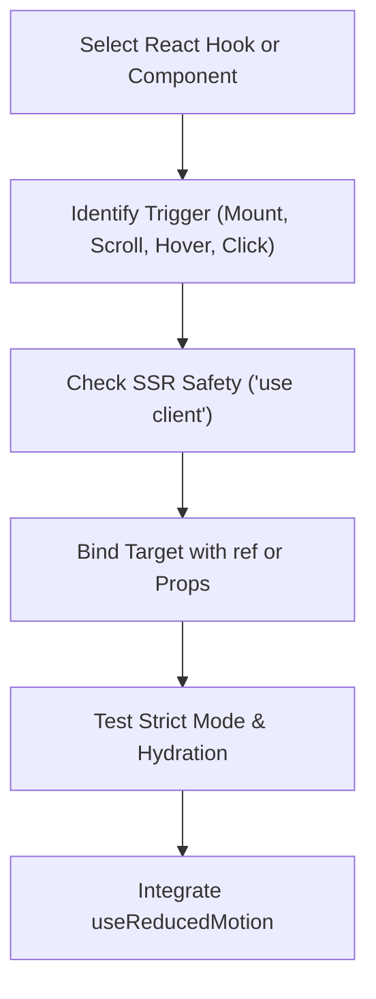

# React Animation Development

AF Motion provides ergonomic, high-performance React bindings optimized for React 18 and 19, Strict Mode resilience, zero hydration mismatches, and Next.js App Router support.

---

## 1. When to Use & When NOT to Use

### When to Use
- When animating UI components in React applications.
- When creating scroll-triggered entrances using `<ScrollReveal>` or `useInView`.
- When animating staggered lists, grids, or typography with `<Stagger>` and `<AnimatedText>`.
- When providing theme palettes or motion personalities via `<MotionProvider>`.
- When handling microinteractions on buttons, cards, or inputs via `<Interactive>`.

### When NOT to Use
- For pure DOM script animation without React (use `fundamentals`).
- When composing raw WebGL shaders (use `graphics-effects`).
- When building Three.js 3D environments (use `3d-scene-development`).

---

## 2. Step-by-Step Agent Workflow



1. **Choose Component vs. Hook**:
   - Use declarative components (`<Reveal>`, `<ScrollReveal>`, `<Stagger>`, `<Interactive>`) for common layout entrances and interactions.
   - Use hooks (`useAnimate`, `useScrollProgress`, `useInView`, `useMicrointeraction`) for custom orchestration, canvas binding, or conditional logic.
2. **Ensure SSR & Hydration Safety**:
   - Always ensure animations start from an initial visual state that matches server HTML or uses CSS visibility to prevent layout shifts.
   - In Next.js App Router, mark the module with `"use client";`.
3. **Strict Mode Resilience**:
   - AF Motion hooks are designed to safely mount, unmount, and remount during React 18/19 Strict Mode without leaking animation frames, timers, or duplicate listeners.

---

## 3. Core React APIs & Patterns

### 3.1 Declarative Component Primitives

| Component | Description | Common Props |
| :--- | :--- | :--- |
| `<Reveal>` | Mount entrance animation | `effect="fade-up"`, `duration={400}`, `delay={100}` |
| `<ScrollReveal>` | Viewport-triggered scroll entrance | `threshold={0.2}`, `once={true}`, `direction="up"` |
| `<Stagger>` | Orchestrates child element stagger | `staggerMs={60}`, `direction="forward"` |
| `<AnimatedText>` | Split-text typography effects | `variant="reveal"`, `split="words"`, `speed={1}` |
| `<Interactive>` | Spring-based hover and press feedback | `scale={1.03}`, `tilt={true}`, `glow={true}` |
| `<MotionProvider>` | Context provider for palette and DNA | `palette="nordic-frost"`, `motionDNA="playful"` |

### 3.2 Key React Hooks

| Hook | Purpose | Return Values |
| :--- | :--- | :--- |
| `useAnimate(ref, config)` | Direct DOM keyframe animation | `{ isAnimating, progress, cancel, restart }` |
| `useInView(ref, options)` | Viewport intersection detection | `{ inView, entry }` |
| `useScrollProgress(options)`| Scroll position tracking (0 to 1) | `{ scrollYProgress, scrollXProgress }` |
| `useReducedMotion()` | System reduced-motion preference | `boolean` |
| `useTilt(ref, options)` | 3D perspective tilt on mousemove | `{ tiltX, tiltY, reset }` |

---

## 4. Copyable Implementation Examples

### Example A: Viewport Scroll Reveal with Staggered List
```tsx
"use client";

import React from "react";
import { Reveal } from "af-motion/react";

interface Feature {
  id: string;
  title: string;
  description: string;
}

export function FeatureSection({ features }: { features: Feature[] }) {
  return (
    <section className="features-grid">
      <Reveal effect="fade-up" duration={500}>
        <h2 className="section-title">Engineered for Performance</h2>
      </Reveal>

      <div className="stagger-container">
        {features.map((feature) => (
          <Reveal key={feature.id} effect="fade-up">
            <div className="feature-card">
              <h3>{feature.title}</h3>
              <p>{feature.description}</p>
            </div>
          </Reveal>
        ))}
      </div>
    </section>
  );
}
```

### Example B: Custom Interactive Card with `useAnimate` & `useReducedMotion`
```tsx
"use client";

import React, { useRef } from "react";
import { useAnimate, useMotionAccessibility } from "af-motion/react";
import { easings } from "af-motion";

export function ActionCard({ title, onSelect }: { title: string; onSelect: () => void }) {
  const cardRef = useRef<HTMLDivElement>(null);
  const { prefersReducedMotion: prefersReduced } = useMotionAccessibility();

  const { cancel, restart } = useAnimate(cardRef, {
    keyframes: prefersReduced
      ? { opacity: [0.8, 1] }
      : {
          transform: ["scale(0.96) translateY(8px)", "scale(1) translateY(0px)"],
          opacity: [0, 1],
        },
    duration: prefersReduced ? 150 : 350,
    easing: easings.easeOutQuad,
  });

  return (
    <div
      ref={cardRef}
      className="action-card"
      onClick={onSelect}
      onMouseEnter={() => !prefersReduced && restart()}
    >
      <h3>{title}</h3>
    </div>
  );
}
```

---

## 5. Accessibility & Performance Best Practices

- **Strict Mode Lifecycle**: Never store animation state in mutable module globals; use `useRef()` or hook controls so components remain isolated during hot reloads or test remounts.
- **Hydration Mismatches**: Render components with default CSS classes on the server and let AF Motion attach transforms only after mount.
- **Memory Management**: Cleanup functions returned by `useAnimate` and `useInView` automatically cancel requestAnimationFrame loops and observer subscriptions on unmount.

---

## 6. Common Pitfalls & Troubleshooting

| Issue | Cause | Fix |
| :--- | :--- | :--- |
| Flickering on initial page load | Server HTML and initial client animation keyframe mismatch | Use `<Reveal>` or `<ScrollReveal>` which apply initial CSS state before animation runs. |
| Duplicate animations firing | Missing dependencies in hook options | Pass memoized options to hooks or wrap dynamic configs in `useMemo()`. |
| Missing ref warning in console | Passing ref to child that doesn't forward it | Wrap custom child components in `React.forwardRef()`. |

---

## 7. Related Skills
- [fundamentals](file:///skills/fundamentals/SKILL.md)
- [interactive-components](file:///skills/interactive-components/SKILL.md)
- [transitions-scroll](file:///skills/transitions-scroll/SKILL.md)
