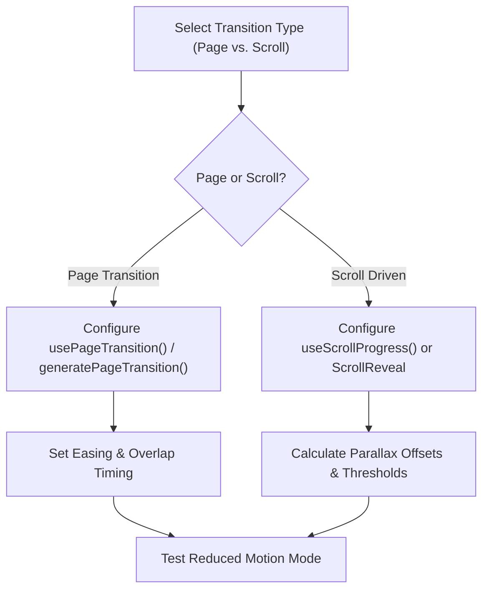

# Transitions & Scroll Experiences

AF Motion includes dedicated transition and scroll intelligence engines capable of orchestrating fluid view transitions, shared element animations, and high-performance scroll storytelling.

---

## 1. When to Use & When NOT to Use

### When to Use
- When animating page or route transitions in Next.js or React Router.
- When revealing sections as they scroll into the viewport (`<ScrollReveal>`, `useInView`).
- When binding object positions, scales, or rotations to scroll progress (`useScrollProgress`, `useParallax`).
- When implementing pinned or sticky storytelling sections with multi-step reveals.
- When generating coordinated entrance and exit sequences.

### When NOT to Use
- For isolated button clicks or hover states (use `interactive-components`).
- For 3D camera path transitions in a canvas scene (use `3d-scene-development`).

---

## 2. Step-by-Step Agent Workflow



1. **Classify Intent**: Decide whether the motion is event-driven (page route change, dialog opening) or scroll-driven (continuous progress or viewport entry).
2. **Select Scroll Strategy**:
   - Discrete trigger: Use `<ScrollReveal threshold={0.2}>` for one-time or re-triggerable entrances.
   - Continuous scroll progress: Use `useScrollProgress()` and interpolate values across [0, 1].
   - Multi-layer depth: Use `useParallax(ref, { speed: 0.4 })`.
3. **Handle Route Transitions**: Wrap page layouts with `<PageTransition>` or configure exit before enter sequencing.
4. **Enforce Reduced Motion**: Ensure scroll-linked movement ceases when reduced motion is preferred, defaulting to standard static document flow.

---

## 3. Core APIs & Patterns

### 3.1 Transition Intelligence APIs

| API | Type | Purpose |
| :--- | :--- | :--- |
| `generateEntranceTransition(config)` | Catalogue | Generates coordinated keyframes and delays for component entrances |
| `generateExitTransition(config)` | Catalogue | Generates unmount animations preserving layout stability |
| `generatePageTransition(config)` | Catalogue | Plans page transition sequence (crossfade, slide, shared-element) |
| `useTransition(state, options)` | React Hook | Manages enter/exit animation states and DOM unmounting |

### 3.2 Scroll Intelligence APIs

| API | Type | Purpose |
| :--- | :--- | :--- |
| `<ScrollReveal>` | React Component | Declarative viewport intersection reveal |
| `useScrollProgress(options)` | React Hook | Returns normalized scroll progress (`0` to `1`) |
| `useScrollVelocity()` | React Hook | Returns instant scroll speed and direction |
| `useParallax(ref, { speed })` | React Hook | Automatically translates element relative to scroll |
| `generateScrollAnimationPlan(intent)`| Catalogue | Plans sticky storytelling, parallax offsets, and reveals |

---

## 4. Copyable Implementation Examples

### Example A: Page Transition Sequence
```tsx
"use client";

import React, { useRef } from "react";
import { useAnimate } from "af-motion/react";
import { easings } from "af-motion";

export function PageTransitionWrapper({
  children,
  pageKey,
}: {
  children: React.ReactNode;
  pageKey: string;
}) {
  const containerRef = useRef<HTMLDivElement>(null);

  useAnimate(containerRef, {
    keyframes: {
      opacity: [0, 1],
      transform: ["translateY(16px) scale(0.99)", "translateY(0px) scale(1)"],
    },
    duration: 400,
    easing: easings.easeOutCubic,
  });

  return (
    <div key={pageKey} ref={containerRef} className="page-wrapper">
      {children}
    </div>
  );
}
```

### Example B: Sticky Scroll Storytelling Section
```tsx
"use client";

import React, { useRef } from "react";
import { useScrollProgress } from "af-motion/react";

export function StorySection() {
  const containerRef = useRef<HTMLDivElement>(null);
  const { scrollYProgress } = useScrollProgress({
    target: containerRef,
    offset: ["start start", "end end"],
  });

  // Calculate dynamic scale and opacity from scroll progress
  const scale = 1 + scrollYProgress * 0.5;
  const opacity = scrollYProgress > 0.8 ? 1 - (scrollYProgress - 0.8) * 5 : 1;

  return (
    <div ref={containerRef} className="h-[300vh] relative">
      <div className="sticky top-0 h-screen flex items-center justify-center overflow-hidden">
        <div
          className="story-graphic bg-gradient-to-tr from-indigo-500 to-purple-500 rounded-3xl w-72 h-72"
          style={{
            transform: `scale(${scale})`,
            opacity,
          }}
        />
        <div className="absolute bottom-12 text-center text-white">
          <p>Scroll Progress: {Math.round(scrollYProgress * 100)}%</p>
        </div>
      </div>
    </div>
  );
}
```

### Example C: Multi-Layer Parallax
```tsx
"use client";

import React, { useRef } from "react";
import { useParallax } from "af-motion/react";

export function ParallaxHero() {
  const bgRef = useRef<HTMLDivElement>(null);
  const fgRef = useRef<HTMLDivElement>(null);

  // Background moves slowly, foreground moves faster
  useParallax(bgRef, { speed: -0.2 });
  useParallax(fgRef, { speed: 0.3 });

  return (
    <div className="relative h-[80vh] overflow-hidden flex items-center justify-center">
      <div ref={bgRef} className="absolute inset-0 bg-cover bg-center bg-[url('/mountains.jpg')]" />
      <div ref={fgRef} className="relative z-10 text-white text-center">
        <h1 className="text-6xl font-black">Explore The Frontier</h1>
      </div>
    </div>
  );
}
```

---

## 5. Accessibility & Performance Best Practices

- **Avoid Jitter in Continuous Scroll**: Always drive continuous scroll animations using CSS `transform` or `opacity`. Never manipulate `top`, `margin`, or cause browser reflow on scroll events.
- **Throttling & Passive Listeners**: AF Motion uses passive event listeners and `requestAnimationFrame` coalescing automatically.
- **Reduced Motion Fallback**: When `useReducedMotion()` is true, pin sticky sections in place without scale or parallax distortion.

---

## 6. Common Pitfalls & Troubleshooting

| Issue | Cause | Fix |
| :--- | :--- | :--- |
| Parallax element jumps on initial load | Ref unset or offset calculated before layout measurement | Ensure container has non-zero height before attaching `useParallax()`. |
| Scroll indicator stuck at 0% | Scroll target container is set to `overflow: hidden` | Set `target` to `window` or the specific scrollable element with `overflow: auto`. |

---

## 7. Related Skills
- [fundamentals](file:///skills/fundamentals/SKILL.md)
- [react-animation](file:///skills/react-animation/SKILL.md)
- [choreography-sync](file:///skills/choreography-sync/SKILL.md)
