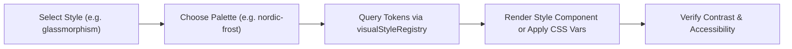

# Visual Styles, Palettes & Design Systems

AF Motion features 19 fully articulated visual design styles and 33 curated color palettes, backed by token contracts and ready-to-use React components.

---

## 1. When to Use & When NOT to Use

### When to Use
- When styling UI components according to a defined aesthetic genre (e.g. Glassmorphism, Neobrutalism, Cyberpunk, Editorial, Claymorphism).
- When applying theme color palettes (`applyPalette`, `activatePalette`, `<PaletteProvider>`).
- When querying design tokens for border radiuses, shadow blurs, backdrop filters, or accent colors.
- When generating cohesive cross-component styles with matching motion physics.

### When NOT to Use
- For raw mathematical spring physics without styling (use `fundamentals`).
- When writing custom WebGL shader logic from scratch (use `graphics-effects`).

---

## 2. The 19 Visual Styles

The Visual Style Registry classifies styles across 5 categories:

| Category | Styles | Typical Tokens & Motion Feel |
| :--- | :--- | :--- |
| **Modern & Minimal** | `minimal`, `editorial`, `swiss`, `bauhaus`, `brutalist` | Crisp borders, monochrome + sharp accents, snappy linear or ease-out curves |
| **Depth & Surface** | `glassmorphism`, `neumorphism`, `skeuomorphism`, `claymorphism` | Frosted backdrop filters, multi-layered soft drop shadows, pneumatic spring response |
| **Vibrant & Futuristic**| `cyberpunk`, `vaporwave`, `psychedelic`, `neon` | Glowing outlines, high-contrast saturations, chromatic aberration, rapid pulse animations |
| **Material & Organic** | `aurora`, `liquid`, `organic`, `art-nouveau` | Mesh gradients, fluid morphing paths, sinusoidal curves, flowing transitions |
| **Industrial & Retro** | `steampunk`, `retro-computing` | Brass/copper bevels, phosphor scanlines, stepped typewriter or mechanical tick curves |

---

## 3. Step-by-Step Agent Workflow



1. **Identify Required Style**: Choose from the 19 supported styles.
2. **Select Compatible Palette**: Pair with one of the 33 palettes (e.g. `nordic-frost`, `neon-cyberpunk`, `tokyo-night`).
3. **Retrieve Tokens**: Call `getVisualStyle("style-name")` to retrieve surface properties, shadow stacks, and border radii.
4. **Render Component**: Use built-in React style components (`<GlassmorphicCard>`, `<NeumorphicCard>`, `<BrutalistBox>`, `<CyberpunkHUD>`) or apply CSS variables to custom elements.
5. **Check WCAG Contrast**: Ensure text elements on glass or dark surfaces meet AA contrast ratios (4.5:1).

---

## 4. API Reference & Code Examples

### Example A: Using Built-in Style Components
```tsx
"use client";

import React from "react";
import { GlassSurface, NeumorphicCard } from "af-motion/react";

export function DashboardPreview() {
  return (
    <div className="grid grid-cols-2 gap-6 p-8">
      {/* Glassmorphic frosted card with dynamic specular highlight */}
      <GlassSurface>
        <h3 className="text-xl font-bold">System Telemetry</h3>
        <p className="text-sm opacity-80">All services operational.</p>
      </GlassSurface>

      {/* Cyberpunk HUD panel with angled chamfered corners & neon glow */}
      <NeumorphicCard>
        <div className="hud-content">
          <span className="label">CORE FREQUENCY</span>
          <span className="value">4.82 GHz</span>
        </div>
      </NeumorphicCard>
    </div>
  );
}
```

### Example B: Activating Palettes Programmatically
```ts
import { activatePalette, listPalettes, getPalette } from "af-motion";

// List available palettes
const palettes = listPalettes();
console.log("Total palettes:", palettes.length); // 33 palettes

// Activate a palette (injects CSS variables onto documentElement)
activatePalette("nordic-frost");

// Inspect tokens
const current = getPalette("nordic-frost");
console.log("Primary Color:", current?.colors.primary);
console.log("Background:", current?.colors.background);
```

### Example C: Querying Style Tokens for Custom CSS
```ts
import { visualStyleRegistry } from "af-motion/catalogue";

const neobrutalism = visualStyleRegistry.getVisualStyle("brutalist");

if (neobrutalism) {
  console.log("Border Width:", neobrutalism.tokens.borderWidth); // e.g. "3px"
  console.log("Shadow:", neobrutalism.tokens.boxShadow);         // e.g. "4px 4px 0px #000"
  console.log("Default Easing:", neobrutalism.tokens.easing);
}
```

---

## 5. Accessibility & Contrast Guidelines

- **Glassmorphism**: Ensure background contrast is sufficient behind semi-transparent cards. If needed, supply a darker overlay layer.
- **Neumorphism**: Neumorphic button borders often have low contrast against surrounding surfaces. Always provide a clear outline or distinct icon/text color for keyboard focus.
- **Cyberpunk / Neon**: Avoid high-frequency strobe animations (> 3 flashes/second) to satisfy WCAG 2.3.1.

---

## 6. Common Pitfalls & Troubleshooting

| Issue | Cause | Fix |
| :--- | :--- | :--- |
| Glassmorphism blur not showing | Missing background content behind card | Glassmorphism requires an underlying image, gradient, or canvas to exhibit frosted blur. |
| Palette colors not applying | Missing call to `activatePalette()` or `<PaletteProvider>` | Wrap your app root in `<PaletteProvider palette="tokyo-night">` or call `activatePalette()`. |

---

## 7. Related Skills
- [fundamentals](file:///skills/fundamentals/SKILL.md)
- [react-animation](file:///skills/react-animation/SKILL.md)
- [graphics-effects](file:///skills/graphics-effects/SKILL.md)
